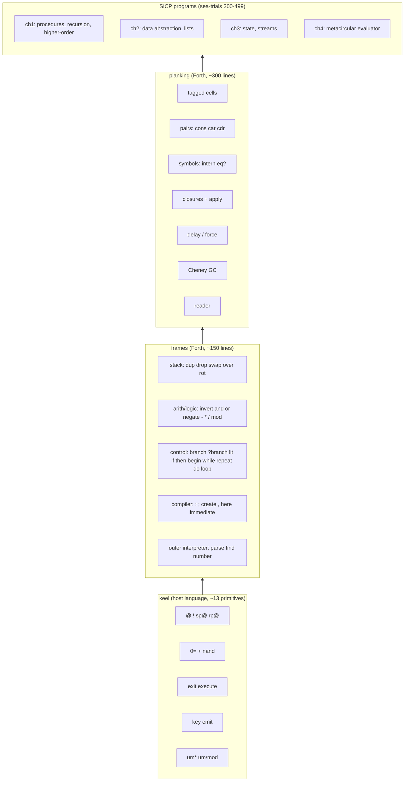
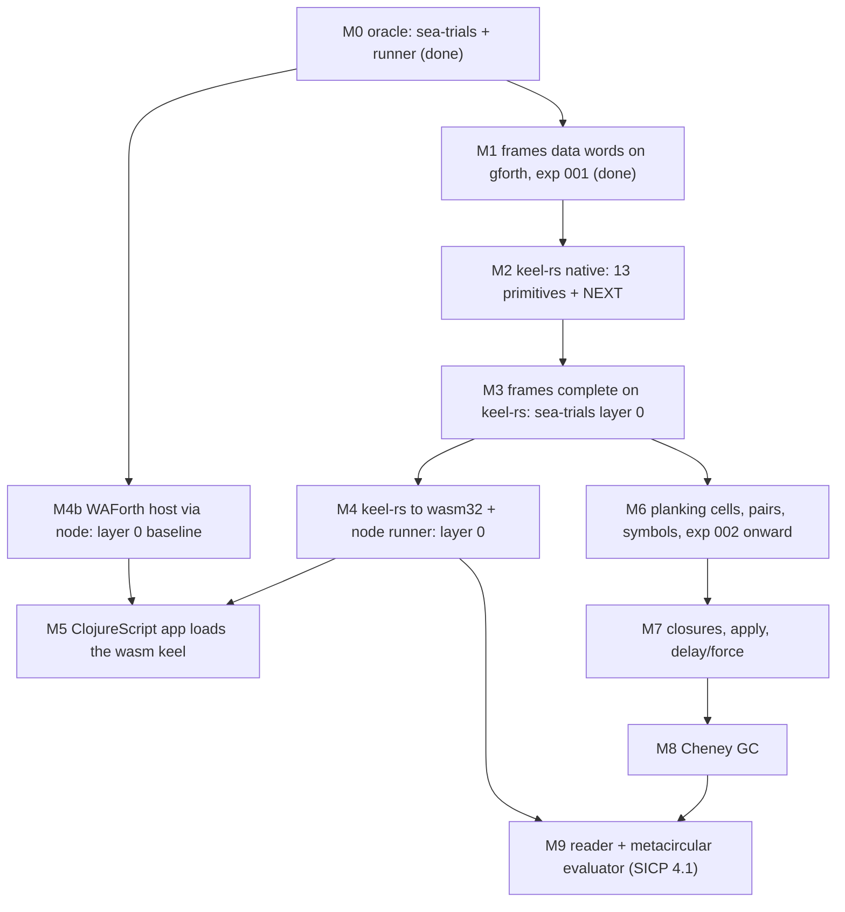

> Derived from spec.org @ v0.1. The spec governs; if this file disagrees with it, this file is the bug. Do not add facts here that are not in the spec — add them to the spec first.

# forth-keel

A Forth system built in three layers, each written on top of the one
below, and tested against a fixed oracle corpus of SICP programs.

| Layer    | Written in | Contents |
|----------|------------|----------|
| keel     | host language (Rust, C) | 13 primitives and the inner interpreter |
| frames   | Forth | stack words, arithmetic, control flow, compiler, outer interpreter |
| planking | Forth | tagged cells, pairs, symbols, closures, promises, Cheney GC, reader |

## Build sequence

## Commands

- `make test` — code gate: experiments and sea-trials on gforth
- `make docs` — docs gate, including negative fixtures
- `make tangle` — regenerate derived files from `spec.org`
- `make tangle-check` — confirm derived files match `spec.org`
- `scripts/pull-resources.sh` — fetch reference sources into `resources/vendor/`

All diagrams: [docs/architecture.md](docs/architecture.md).
Governing spec: [spec.org](spec.org).
