> Derived from spec.org @ v0.1. The spec governs; if this file disagrees with it, this file is the bug. Do not add facts here that are not in the spec — add them to the spec first.

# forth-keel architecture

Diagram sources are in [diagrams/](diagrams/). Text, requirements and
labels are in [../spec.org](../spec.org).

## 1. Kernel levels

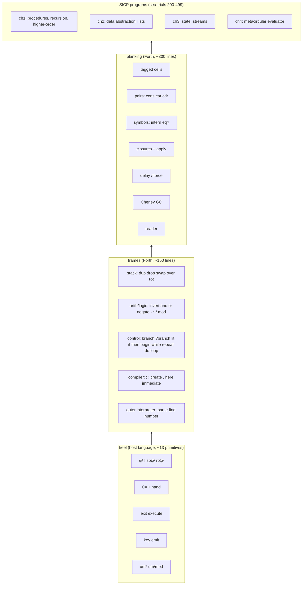

## 2. Primitive derivation

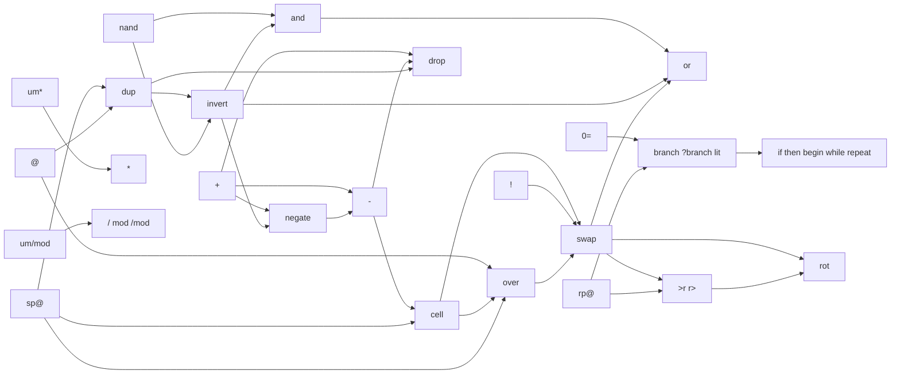

## 3. Memory map

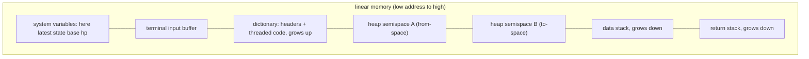

## 4. Inner and outer interpreter

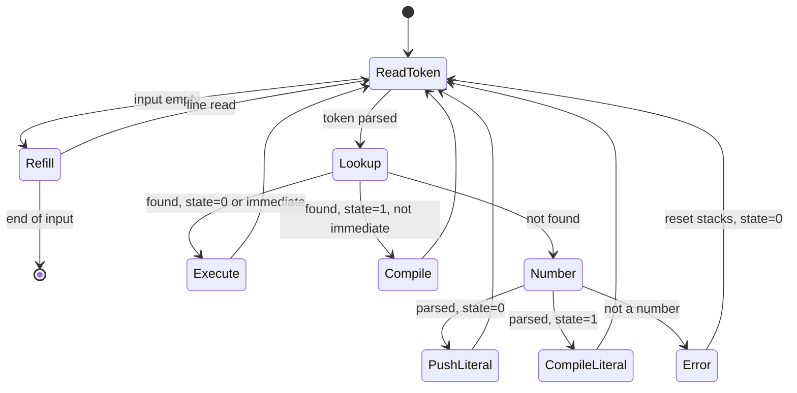

## 5. Object layout (planking)

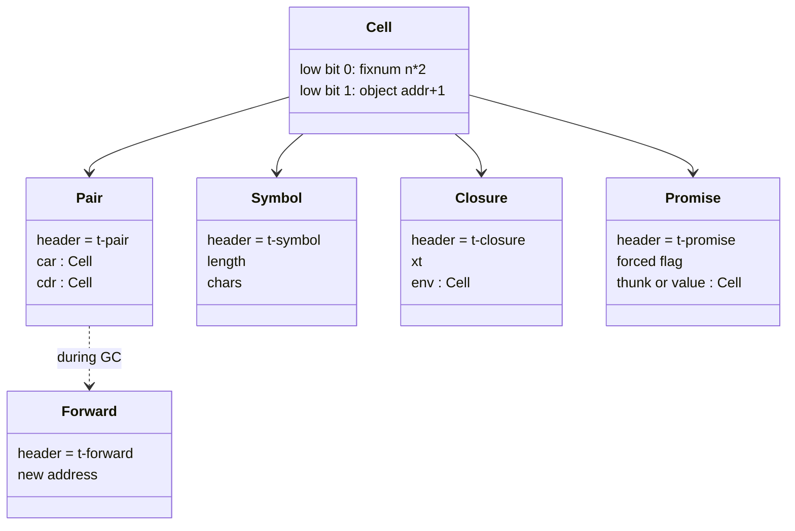

## 6. Garbage collection (Cheney)

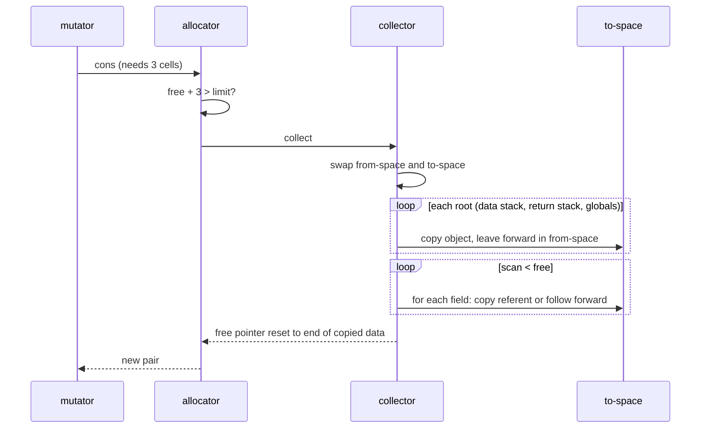

## 7. System context

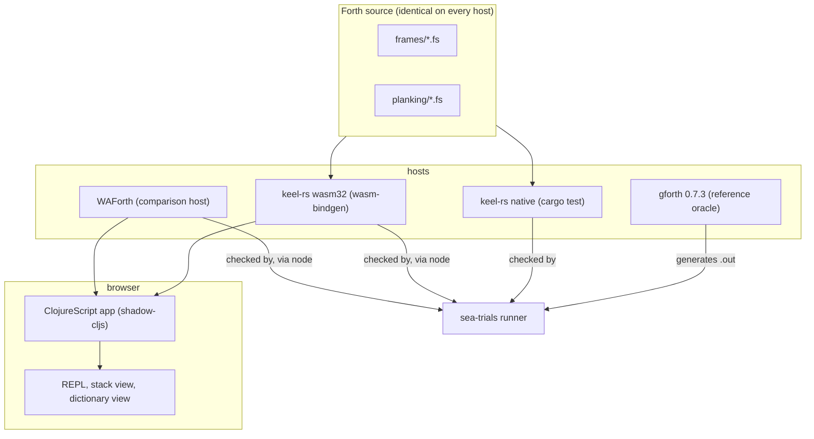

## 8. ClojureScript interop

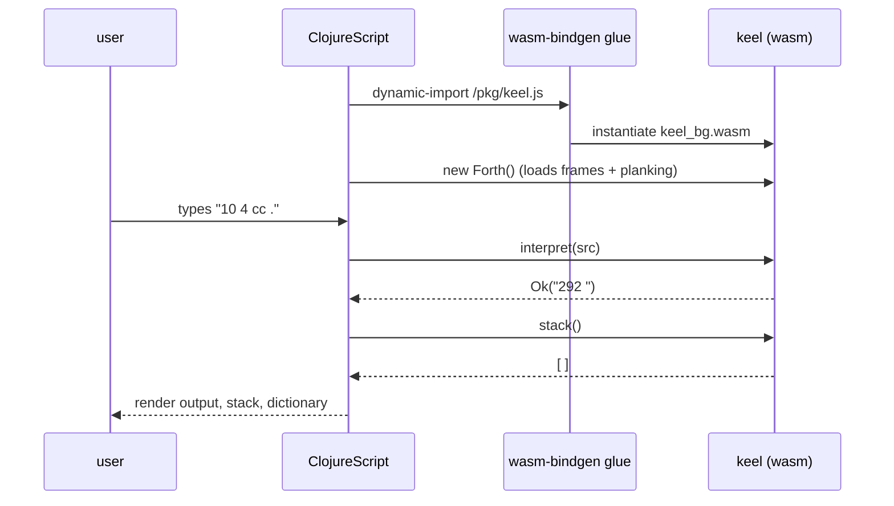

## 9. Build sequence

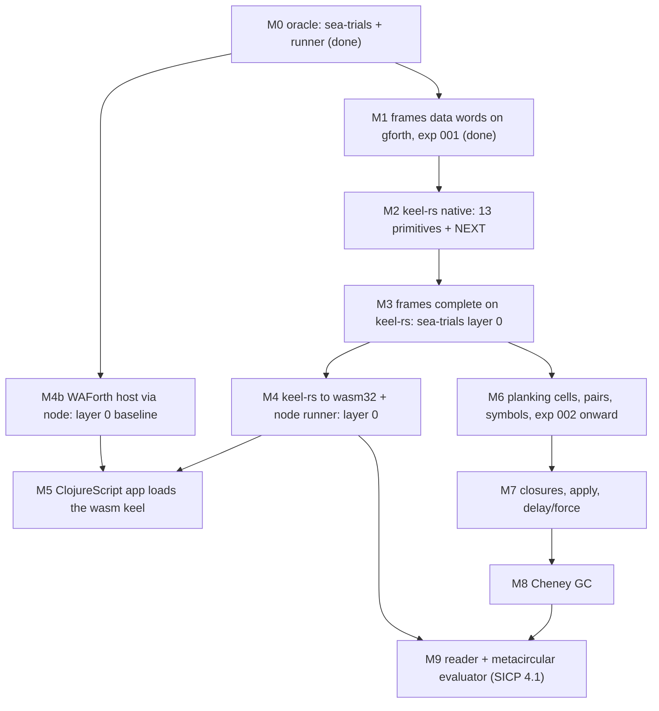

## 10. Gating by sea-trials layer

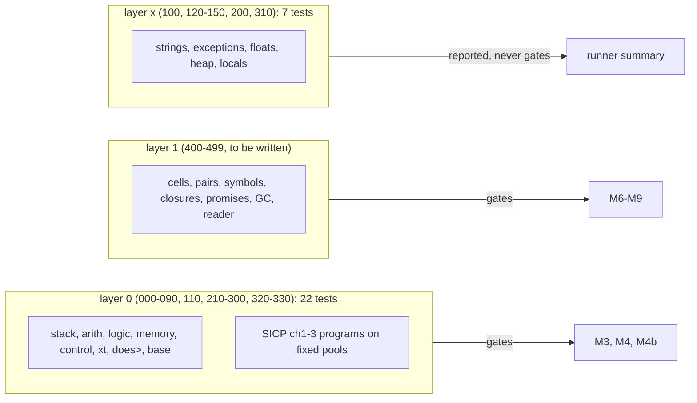

## 11. Incremental development loop

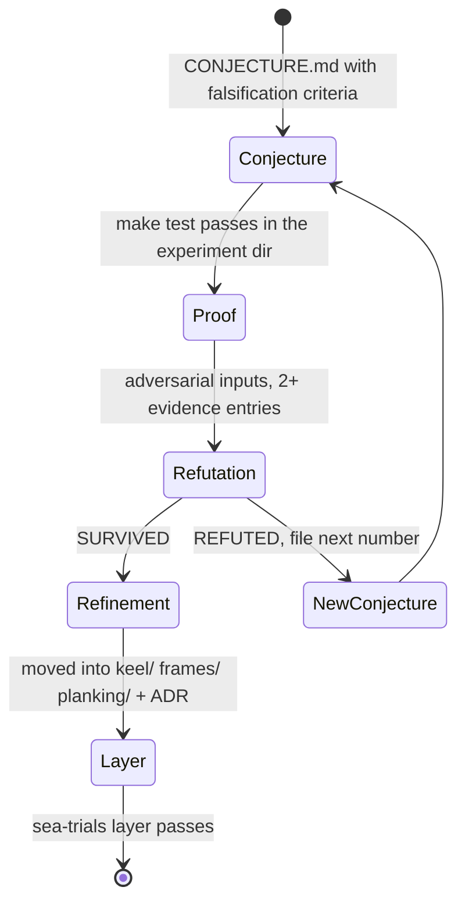

## 12. Repository layout

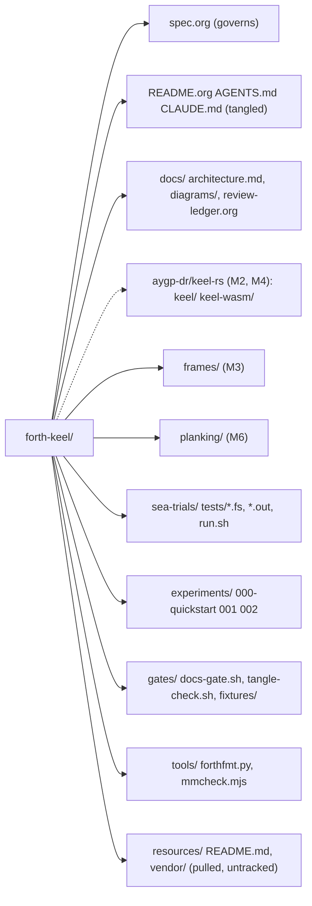
